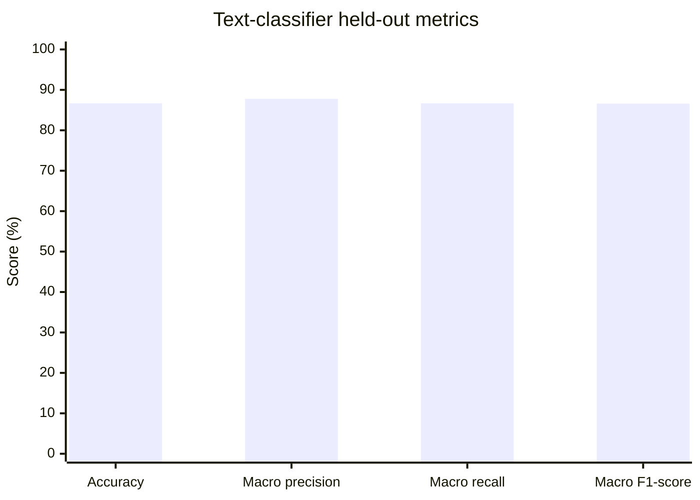
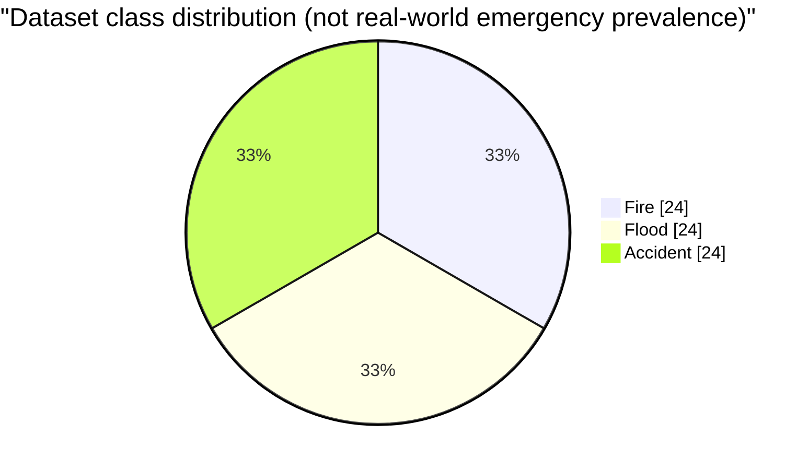

# ReliefLink

ReliefLink is a disaster-response capstone platform connecting victim SOS reports with text classification, image classification, multimodal fusion, explainable AI, emergency prioritization, responder coordination, and a real-time operational dashboard.

## Problem and objectives

Emergency information is often fragmented across descriptions, images, responders, facilities, and resources. ReliefLink provides one workflow for capturing an SOS, preserving the original report, analyzing available modalities, coordinating registered responders, and exposing status changes to authorized users.

The system supports exactly three emergency classes: `Fire`, `Flood`, and `Accident`. It does not process audio or sensor inputs.

## Architecture

- `client/`: React, Vite, Tailwind, React Leaflet, and Socket.IO client.
- `server/`: Express, MongoDB/Mongoose, JWT authorization, Multer image uploads, Socket.IO, and the Phase 8 integration service.
- `ai-service/`: FastAPI endpoints for NLP, computer vision, multimodal fusion, and explainability.
- `docs/`: technical requirements and final verification reports.

Workflow:

```text
Victim SOS
  -> text and optional image
  -> NLP and/or computer vision
  -> weighted multimodal fusion
  -> explainable AI
  -> priority and emergency update
  -> volunteer, facility, and resource coordination
  -> Socket.IO dashboard updates
```

The Node integration service preserves raw modality results, fusion output, explanation evidence, and verification state. If the AI service fails, the original SOS is retained and the emergency is marked `Failed`.

## Technology stack

- Frontend: React 18, Vite, Tailwind CSS, Leaflet/OpenStreetMap, Socket.IO Client.
- Backend: Node.js, Express, Mongoose, MongoDB, JWT, Socket.IO, Multer.
- AI service: Python 3, FastAPI, scikit-learn, joblib, TensorFlow/Keras, Pillow.

## AI pipeline

### NLP methodology

Phase 4 uses a persisted TF-IDF vectorizer and Logistic Regression model. The development dataset contains 12 labeled text examples across Fire, Flood, and Accident. Its metrics are development-set/training-set metrics, not independent generalization measurements.

### Computer vision methodology

Phase 5 uses frozen MobileNetV2 transfer learning with a custom classification head. Images are resized to 224x224 RGB and validated before inference. The current dataset contains 4 images per class, 12 total. The validation split contains only 3 images, one per class, so its perfect score is a pipeline check rather than evidence of real-world reliability.

### Multimodal fusion

Phase 6 combines class probability distributions with default weights of 0.5 text and 0.5 image. Single-modality requests use a weight of 1.0 for the available modality. If both top predictions differ and both confidences are at least 0.70, the result is `Verification Required`; no class is selected automatically.

### Explainable AI

Phase 7 reports only model outputs and configured modality contributions. It does not invent keywords, visual evidence, causal claims, or heatmaps. Missing modalities are explicitly represented as unavailable.

## Emergency coordination

Phase 8 stores AI status, prediction, confidence, probabilities, explanation, evidence, priority, verification fields, recommendations, and assigned volunteer information on the Emergency record. Priority is a deterministic project decision-support rule, not medically or scientifically validated triage.

Phase 9 provides an authorized real-time dashboard with:

- live emergency list and counters
- Leaflet map markers from stored coordinates only
- AI results, explanation, evidence, verification, priority, and status
- registered hospital, shelter, and resource recommendations
- volunteer assignment and status controls
- Socket.IO notifications and live record updates

Victims can view their own emergencies. Volunteers see assigned emergencies. NGO, hospital, authority, and admin access follows the existing role permissions; authority and admin roles can verify AI conflicts.

## API overview

AI service:

- `GET /health`
- `POST /api/v1/predict/text`
- `POST /api/v1/predict/image`
- `POST /api/v1/fusion/predict`
- `POST /api/v1/explain`

Backend:

- `POST /api/emergencies`
- `GET /api/emergencies/my`
- `GET /api/emergencies/active`
- `GET /api/emergencies/stats`
- `GET /api/emergencies/:id`
- `POST /api/emergencies/:id/process-ai`
- `GET /api/emergencies/:id/ai-result`
- `GET /api/emergencies/:id/recommendations`
- `POST /api/emergencies/:id/verify`
- `PATCH /api/emergencies/:id/status`
- `PATCH /api/emergencies/:id/assign-volunteer`
- `GET /api/volunteers/available`
- `GET /api/resources/available`

## Socket.IO events

The backend emits or the dashboard listens for:

`emergency:created`, `emergency:ai-processing`, `emergency:ai-completed`, `emergency:verification-required`, `emergency:priority-updated`, `emergency:volunteer-assigned`, `emergency:facility-recommended`, `emergency:ai-failed`, and `emergency:status-updated`.

## Dataset and evaluation

Real image files are stored in `ai-service/data/image_dataset/` under the three supported class directories. The reproducible Phase 10 evaluator is:

```text
cd relieflink/ai-service
python scripts/evaluate_phase10.py
```

It writes `models/phase10_evaluation_report.json`. The current report records 1.0 development-set NLP metrics and 1.0 image metrics on the available images, but explicitly marks both evaluations as non-independent. Computer vision has only 4 images per class, and no scientific reliability claim is made.

## Results and Performance Evaluation

The proposed ReliefLink system is evaluated using classification metrics for its three emergency categories: Fire, Flood, and Accident. The metrics below describe the text classifier only unless explicitly stated otherwise.

### Statistical results

For each class in the multiclass task, the following measures are computed using a one-versus-rest interpretation. Precision, recall, and F1-score are reported as macro averages: the metric is calculated separately for each class and then averaged with equal weight across the three classes.

| Metric | Definition | Formula |
| --- | --- | --- |
| Accuracy | Proportion of total predictions that are correct. | `Accuracy = (TP + TN) / (TP + TN + FP + FN)` |
| Precision | Proportion of predicted positive cases that are correct. | `Precision = TP / (TP + FP)` |
| Recall (Sensitivity) | Proportion of actual positive cases correctly detected. | `Recall = TP / (TP + FN)` |
| F1-score | Harmonic mean of precision and recall. | `F1-score = 2 × (Precision × Recall) / (Precision + Recall)` |

Here, **TP** (true positive) is a correctly predicted positive case, **TN** (true negative) is a correctly predicted negative case, **FP** (false positive) is a negative case incorrectly predicted as positive, and **FN** (false negative) is a positive case incorrectly predicted as negative. For each class, the other two classes are treated as the negative class in this interpretation.

### Proposed text-classifier results

The current training metadata records 72 valid labeled text records, balanced equally across the three classes. A stratified train/test split with random state 42 used 57 records for training the evaluation model and held out 15 records (5 per class) for evaluation. The reported held-out metrics were calculated before the final model was refit on all 72 records. The model is TF-IDF with Logistic Regression.

| Evaluation item | Result |
| --- | --- |
| Dataset size | 72 records |
| Fire | 24 records |
| Flood | 24 records |
| Accident | 24 records |
| Model | TF-IDF + Logistic Regression |
| Evaluation method | Stratified train/test split; random state 42 |
| Evaluation training subset | 57 records |
| Held-out test subset | 15 records; 5 per class |
| Accuracy | 86.67% |
| Macro precision | 87.78% |
| Macro recall | 86.67% |
| Macro F1-score | 86.60% |

The held-out test set is small, so these results are preliminary and subject to substantial sampling uncertainty. They apply to the text classifier under this split only; they do not establish the performance of the image model, multimodal fusion system, or entire ReliefLink platform. The values above are recorded in [`text_training_metadata.json`](ai-service/models/text_training_metadata.json). They are distinct from the earlier development-set checks described in the Phase 10 evaluator documentation.

### Existing-versus-proposed comparison

The project documentation describes a fragmented existing emergency-reporting workflow but does not define a reproducible legacy model or baseline test set. The “Existing” column therefore summarizes only documented evidence; it does not imply unreported capabilities or measurements.

| Aspect | Existing/manual workflow documented in project | Proposed ReliefLink system |
| --- | --- | --- |
| Emergency input | Emergency information is described as fragmented across descriptions, images, responders, facilities, and resources; specific baseline input capabilities are not evaluated. | SOS text, optional image, and GPS location are supported by the documented workflow. |
| Text classification | No baseline text classifier or evaluation is documented. | TF-IDF + Logistic Regression predicts Fire, Flood, or Accident; held-out evaluation is reported above. |
| Image classification | No baseline image classifier or evaluation is documented. | MobileNetV2 transfer learning is implemented for the three classes; no independent image test-set result is established. |
| Multimodal fusion | No baseline fusion method or result is documented. | Text and image probability distributions use configured weighted fusion; when both are available, the documented default weights are 0.5/0.5. |
| Uncertainty handling | No baseline uncertainty policy is documented. | Conflicting high-confidence modality predictions can be marked Verification Required for manual review. |
| Explainability | No baseline explanation capability is documented. | The AI service reports model outputs and configured modality contributions; it does not claim unsupported feature or visual evidence. |
| Accuracy | Not yet evaluated. | Text classifier: 86.67% on the 15-record held-out set. Image, fusion, and end-to-end accuracy: Not yet evaluated. |
| Precision | Not yet evaluated. | Text classifier macro precision: 87.78%. Image, fusion, and end-to-end precision: Not yet evaluated. |
| Recall | Not yet evaluated. | Text classifier macro recall: 86.67%. Image, fusion, and end-to-end recall: Not yet evaluated. |
| F1-score | Not yet evaluated. | Text classifier macro F1-score: 86.60%. Image, fusion, and end-to-end F1-score: Not yet evaluated. |

A fair numerical comparison requires the baseline and proposed models to be evaluated on the same independent test set using the same class definitions and metrics. Since such baseline results are not available, a numerical existing-versus-proposed chart is not presented.

### Graphical results

The following Mermaid charts visualize the verified text-classifier metrics and dataset counts. The class-distribution chart describes the dataset composition, not the distribution of real-world emergencies.

**Text-classifier metrics (held-out evaluation, percent)**



**Dataset class distribution (72 records; dataset composition only)**



### Results discussion

The initial held-out evaluation suggests that the text classifier can distinguish the three emergency categories in the current dataset. However, the test set contains only 15 records, so the results provide limited confidence about performance on new reports or real-world emergencies. The reported metrics should be interpreted as preliminary rather than as evidence of operational reliability.

Multimodal fusion combines available text and image model outputs, while uncertainty-driven verification routes qualifying disagreements for human review rather than forcing an automatic class decision. These design features describe the intended decision workflow; no measured accuracy improvement from fusion or verification is claimed because a valid comparative experiment has not been reported.

Future evaluation should use a larger, independently labeled test dataset and separately measure image classification, multimodal fusion, and end-to-end emergency workflows. Baseline and proposed systems should be compared on the same independent data with consistent class definitions and metrics.

## Testing

Backend tests:

```text
cd relieflink/server
npm install
npm test
```

The server tests use mocked Mongoose models and local HTTP servers. They do not
connect to MongoDB, create database records, or clean up a database.

### Local staging integration setup

The existing `server/.env` may contain non-staging credentials and must not be
used for staging. Create the ignored `server/.env.staging` from the
placeholder-only `server/.env.staging.example`, then replace its placeholders
with values for a dedicated staging cluster:

```dotenv
NODE_ENV=staging
STAGING_MONGODB_URI=mongodb+srv://<dedicated-staging-user>:<password>@<staging-cluster>.mongodb.net/relieflink_staging?retryWrites=true&w=majority
JWT_SECRET=<new-random-staging-only-secret>
PORT=5000
CLIENT_URL=http://localhost:5173
AI_SERVICE_HOST=127.0.0.1
AI_SERVICE_PORT=8000
```

Supply a dedicated staging/test database and a least-privilege database user.
Do not copy `MONGODB_URI` or credentials from `server/.env`; staging mode loads
only `.env.staging`, requires `STAGING_MONGODB_URI`, and never falls back to
`MONGODB_URI`. Keep `.env.staging` local; the repository ignores it.
The database name in the staging URI must include a `staging`, `stage`, `test`,
or `testing` marker (for example, `relieflink_staging`).
Do not add admin bootstrap credentials: automatic admin bootstrap is skipped
in staging so starting the service does not create or modify a user.

From PowerShell, start the combined backend and AI process in one terminal:

```powershell
Set-Location relieflink/server
if (Test-Path .env.staging) { throw 'Preserving existing .env.staging; edit it without overwriting.' }
Copy-Item .env.staging.example .env.staging
# Edit .env.staging with the dedicated staging URI and a new staging-only JWT secret.
$env:NODE_ENV = 'staging'
npm run staging:preflight
npm run dev
```

`npm run dev` starts Express and its local FastAPI child process. To run the AI
service by itself for API checks, use a separate terminal and do not run it at
the same time as the backend-managed AI process on port 8000:

```powershell
Set-Location relieflink/ai-service
.\.venv\Scripts\python.exe -m uvicorn app.main:app --host 127.0.0.1 --port 8000
```

Run the frontend in another terminal; it uses the backend's same-origin API
and Socket.IO defaults when served by Vite with these local URLs:

```powershell
Set-Location relieflink/client
$env:VITE_API_URL = 'http://127.0.0.1:5000/api'
$env:VITE_SOCKET_URL = 'http://127.0.0.1:5000'
npm run dev -- --host 127.0.0.1
```

Before starting the backend, `npm run staging:preflight` verifies the explicit
staging mode, URI syntax, explicit database name, and that a simultaneously
configured `MONGODB_URI` does not target the same database. It does not connect
to MongoDB. The existing `npm test` suite is safe to run and tests mocked
in-memory behavior; there is currently no live MongoDB staging integration
test suite. Live login, SOS persistence, admin status updates, and Socket.IO
checks require pre-provisioned staging accounts/data and a separately reviewed
test plan. Do not run mutating checks until the dedicated staging URI and
database contents have been verified by the operator.

AI-service tests:

```text
cd relieflink/ai-service
pytest -q
```

Frontend production build:

```text
cd relieflink/client
npm install
npm run build
```

The Phase 10 automated result at the time of this report is 5 backend tests passed, 41 AI-service tests passed, and the frontend build passed. The real-AI test-environment harness uses the running FastAPI service and isolated in-memory backend fixtures; it does not replace MongoDB production verification.

## Deployment

### Single-service Render deployment

The repository includes `render.yaml` and a root `Dockerfile` for one Render Web Service. The Docker image pins Node.js 22 on Debian Bookworm and installs Python 3.11 for the AI virtual environment. The Node/Express process is the public process; it serves the React build and starts FastAPI as a localhost child process. FastAPI is not a separate public Render service. The Docker build excludes environment files so local secrets are not copied into the image.

- Root Directory: repository root (`.`)
- Runtime: Docker, using the root `Dockerfile`
- Image build: installs the frontend/backend dependencies and builds the AI-service virtual environment with Python 3.11
- Start Command: `npm start`
- Root package start script: `node relieflink/server/src/server.js`
- Internal AI URL: `http://127.0.0.1:8000`

The build sets `PYTHON=python3.11`; `scripts/setup_ai_venv.js` verifies that interpreter is Python 3.11 before creating the AI virtual environment and installing `ai-service/requirements.txt`. The virtual-environment interpreter is checked again before dependency installation. On startup, Node launches Uvicorn on `127.0.0.1:8000`, waits for `/health`, then connects to MongoDB and starts the public server on Render's `PORT`. Shutdown signals stop the FastAPI child process. Express serves `client/dist` and Socket.IO remains attached to the same HTTP server.

The backend reads `PORT`, `NODE_ENV`, `MONGODB_URI`, `JWT_SECRET`, `JWT_EXPIRES_IN`, `CLIENT_URL`, `AI_SERVICE_URL`, `AI_SERVICE_HOST`, `AI_SERVICE_PORT`, and `AI_STARTUP_TIMEOUT_MS`. The repository contains only example variable names and no production secret values. `VITE_API_URL` and `VITE_SOCKET_URL` are optional for separate local frontend development; the production build defaults to same-origin `/api` and Socket.IO.

The trained image model and class labels must be present under `ai-service/models/image_classifier/`. The AI service routes remain under `/api/v1` internally.

## Known limitations

- Production MongoDB verification is pending because the current configured URI resolves to the placeholder host `cluster.example.mongodb.net`.
- The Node backend cannot complete startup until valid MongoDB connectivity is provided; MongoDB configuration was not modified.
- The one-service child-process architecture has been tested locally through FastAPI readiness and Node-to-FastAPI integration, but full Render deployment has not been performed.
- The NLP score is measured on the 12 examples used to train the persisted development model, not an independent test set.
- The image dataset has only 4 images per class and the 3-image validation score is not evidence of real-world model reliability.
- The real AI disagreement tested so far did not produce two confidences at the unchanged 0.70 conflict threshold, so a genuine high-confidence `Verification Required` event remains un-demonstrated.
- Coordination and dashboard end-to-end tests use isolated backend fixtures when MongoDB is unavailable. They do not prove production persistence or production Socket.IO behavior.
- Response timing is environment-dependent; first image inference includes TensorFlow/model loading overhead.

## Future scope

Acquire independent, representative datasets; evaluate on held-out data; calibrate confidence; add operational monitoring; validate MongoDB and Socket.IO in a deployed environment; and conduct security, load, and usability testing with authorized stakeholders.

## Final verification

See [PHASE10-FINAL-VERIFICATION-REPORT.md](../docs/PHASE10-FINAL-VERIFICATION-REPORT.md) for the exact automated results, live AI checks, deployment readiness findings, and production verification status.
